# Stage 3a toy distillation: results

**Setup.** Actions `[B, 2, 3]` (2 steps × 2 real dims, dim 2 padded). Task 1 has 2 modes, task 2 has 3, σ = 0.15, and the means shift with o. The initial student was pre-trained on a base distribution with means shifted 0.25 along step-1 (0, 1) on both steps, σ × 1.4, task-2 mode 0 at half weight, for 8,000 steps. Distillation: 3,000 updates, batch 512, Adam 1e-4 (student and fake), 4-step FlowSolve, one training seed (0).
**Eval:** o ∈ {−0.8, 0, 0.8}, n = 2,000 per (task, o), every 250 updates. Every evaluation uses the same eval seed (2026, fixed before any run), i.e. common random numbers. The final and initial students are also evaluated at n = 20,000.
**Metrics:** W2 = sliced W2 on the 4-D vector (mean over o). Coverage = modes holding ≥ 1/(2M) of the samples (nearest centre, within 3σ; min over o). Success = fraction within r = σ√(−2 ln 0.1) of a centre (mean over o). Coverage and success both use **step-1 coordinates**; measuring coverage that way, rather than on the 4-D vector, is a deliberate deviation. "Success within 5 points of the 4-step teacher" is read as success ≥ teacher_4step − 0.05; beating the teacher is fine. All tables below are printed by `python -m distillation.toy.report` from `runs/<run>.json`.

## Reference levels
| level | n | W2 t1 | W2 t2 | cov t1 | cov t2 | succ t1 | succ t2 |
|---|---|---|---|---|---|---|---|
| noise floor | 2,000 | 0.040 | 0.043 | 2/2 | 3/3 | 0.901 | 0.897 |
| 4-step teacher | 2,000 | 0.091 | 0.093 | 2/2 | 3/3 | 0.916 | 0.845 |
| initial student | 2,000 | 0.189 | 0.159 | 2/2 | 3/3 | 0.577 | 0.541 |
| noise floor | 20,000 | 0.010 | 0.014 | 2/2 | 3/3 | 0.900 | 0.901 |
| 4-step teacher | 20,000 | 0.087 | 0.090 | 2/2 | 3/3 | 0.907 | 0.848 |
| initial student | 20,000 | 0.195 | 0.164 | 2/2 | 3/3 | 0.580 | 0.535 |

## Loss variants (λ_IDA = 0.99, K_ψ = 1)
| run | α DMD / FM | λ_IDA | K_ψ | W2 t1 | W2 t2 | cov t1 | cov t2 | succ t1 | succ t2 | W2@20k t1 | W2@20k t2 | wall s | non-finite |
|---|---|---|---|---|---|---|---|---|---|---|---|---|---|
| fm_only | 0 / 1 | 0.99 | 1 | 0.148 | 0.174 | 2/2 | 3/3 | 0.818 | 0.646 | 0.145 | 0.173 | 22 | no |
| dmd_only | 1 / 0 | 0.99 | 1 | 0.196 | 0.154 | 2/2 | 3/3 | 0.973 | 0.938 | 0.195 | 0.156 | 71 | no |
| dmd_fm | 0.5 / 0.5 | 0.99 | 1 | 0.076 | 0.074 | 2/2 | 3/3 | 0.792 | 0.701 | 0.067 | 0.070 | 88 | no |

## IDA sweep (DMD + FM, α = 0.5 / 0.5)
| run | α DMD / FM | λ_IDA | K_ψ | W2 t1 | W2 t2 | cov t1 | cov t2 | succ t1 | succ t2 | W2@20k t1 | W2@20k t2 | wall s | non-finite |
|---|---|---|---|---|---|---|---|---|---|---|---|---|---|
| dmd_fm_lam1_k1 | 0.5 / 0.5 | 1 | 1 | 0.095 | 0.098 | 2/2 | 3/3 | 0.912 | 0.819 | 0.090 | 0.099 | 85 | no |
| dmd_fm | 0.5 / 0.5 | 0.99 | 1 | 0.076 | 0.074 | 2/2 | 3/3 | 0.792 | 0.701 | 0.067 | 0.070 | 88 | no |
| dmd_fm_lam0.9_k1 | 0.5 / 0.5 | 0.9 | 1 | 0.420 | 0.400 | 0/2 | 0/3 | 0.141 | 0.159 | 0.415 | 0.398 | 84 | no |
| dmd_fm_lam0_k1 | 0.5 / 0.5 | 0 | 1 | 0.607 | 0.746 | 1/2 | 1/3 | 0.463 | 0.417 | 0.618 | 0.771 | 75 | no |
| dmd_fm_lam1_k5 | 0.5 / 0.5 | 1 | 5 | 0.046 | 0.052 | 2/2 | 3/3 | 0.867 | 0.830 | 0.038 | 0.049 | 131 | no |
| dmd_fm_lam0.99_k5 | 0.5 / 0.5 | 0.99 | 5 | 0.057 | 0.053 | 2/2 | 3/3 | 0.849 | 0.848 | 0.047 | 0.050 | 125 | no |
| dmd_fm_lam0.9_k5 | 0.5 / 0.5 | 0.9 | 5 | 0.098 | 0.081 | 2/2 | 3/3 | 0.627 | 0.706 | 0.094 | 0.078 | 117 | no |
| dmd_fm_lam0_k5 | 0.5 / 0.5 | 0 | 5 | 2.588 | 3.984 | 0/2 | 0/3 | 0.000 | 0.014 | 2.689 | 4.023 | 133 | no |

Wall times are per run, measured with 4 runs sharing the CPU at 4 threads each (`run_sweep.sh` now runs at most 3 at a time). Total training time over the 10 runs is 931 s; the sweep took 4 min 53 s of wall clock.

## Pass verdict
Pass, per task: W2 reduction ≥ 80%, every mode covered, and success ≥ teacher_4step − 0.05. The W2 reduction is read three ways: (i) literally at n = 2,000; (ii) at n = 2,000 corrected for the noise floor, (W2_init − W2_final)/(W2_init − floor); (iii) literally at n = 20,000.

**DMD + FM as specified (`dmd_fm`: λ_IDA 0.99, K_ψ 1): FAIL under all three readings.** W2 falls by 60/53% (i), 76/73% (ii) and 66/57% (iii). All modes are covered, but success ends at 0.792/0.701, below the bars of 0.866/0.795.

| W2 reading | task | W2 init | W2 final | floor | reduction | cov | succ | teacher − 0.05 | verdict |
|---|---|---|---|---|---|---|---|---|---|
| n=2,000 literal | 1 | 0.189 | 0.076 | - | 60% | 2/2 | 0.792 | 0.866 | FAIL |
| n=2,000 literal | 2 | 0.159 | 0.074 | - | 53% | 3/3 | 0.701 | 0.795 | FAIL |
| n=2,000 floor-corrected | 1 | 0.189 | 0.076 | 0.040 | 76% | 2/2 | 0.792 | 0.866 | FAIL |
| n=2,000 floor-corrected | 2 | 0.159 | 0.074 | 0.043 | 73% | 3/3 | 0.701 | 0.795 | FAIL |
| n=20,000 literal | 1 | 0.195 | 0.067 | - | 66% | 2/2 | 0.780 | 0.857 | FAIL |
| n=20,000 literal | 2 | 0.164 | 0.070 | - | 57% | 3/3 | 0.701 | 0.798 | FAIL |

**DMD + FM with K_ψ = 5, λ_IDA = 1 (`dmd_fm_lam1_k5`):**
- Reading (ii): passes both tasks, but the task-1 success margin is only 0.0007 (0.8672 vs. 0.8665, about 4 of 6,000 samples).
- Reading (iii): passes task 1 and fails task 2 (70%).
- Reading (i): fails (75/68%). The literal n = 2,000 bar (0.038/0.032) lies below this eval seed's n = 2,000 noise floor (0.040/0.043), so exact samples would fail it too.
- With λ_IDA = 0.99, K_ψ = 5, task-1 success (0.849) misses the bar under every reading (`report.py` prints the full table).
- **So no setting clearly passes.** The best one passes only reading (ii), by a 0.0007 success margin, and fails task 2 at n = 20,000.

| W2 reading | task | W2 init | W2 final | floor | reduction | cov | succ | teacher − 0.05 | verdict |
|---|---|---|---|---|---|---|---|---|---|
| n=2,000 literal | 1 | 0.189 | 0.046 | - | 75% | 2/2 | 0.867 | 0.866 | FAIL |
| n=2,000 literal | 2 | 0.159 | 0.052 | - | 68% | 3/3 | 0.830 | 0.795 | FAIL |
| n=2,000 floor-corrected | 1 | 0.189 | 0.046 | 0.040 | 95% | 2/2 | 0.867 | 0.866 | pass |
| n=2,000 floor-corrected | 2 | 0.159 | 0.052 | 0.043 | 92% | 3/3 | 0.830 | 0.795 | pass |
| n=20,000 literal | 1 | 0.195 | 0.038 | - | 81% | 2/2 | 0.869 | 0.857 | pass |
| n=20,000 literal | 2 | 0.164 | 0.049 | - | 70% | 3/3 | 0.829 | 0.798 | FAIL |

## Figures
Metric curves of the three variants, the stable part of the IDA sweep (λ_IDA ≥ 0.99), and the full sweep (dashed: 4-step teacher, dotted: noise floor):
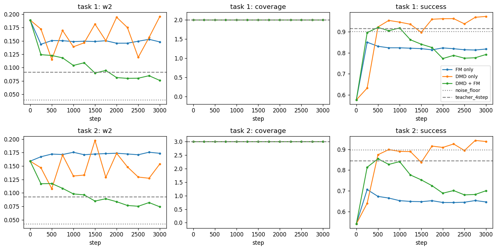
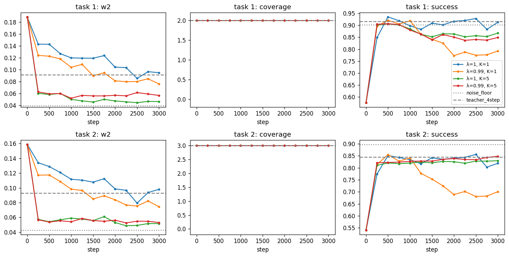
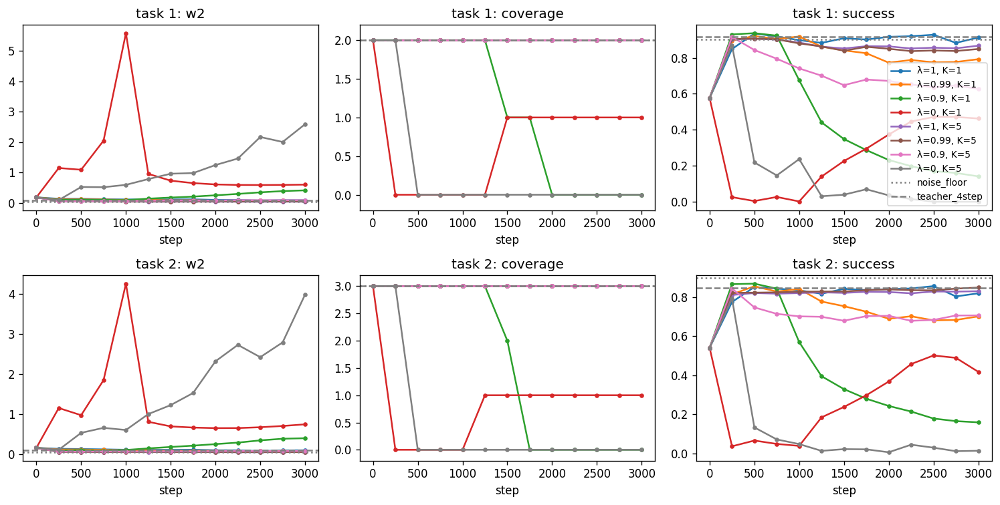

Final samples at o = 0 vs. the exact teacher, then the mean DMD update direction −g (32 (τ, ε) draws, fake = student) on the initial student. The arrows point from the shifted student toward the teacher's modes.
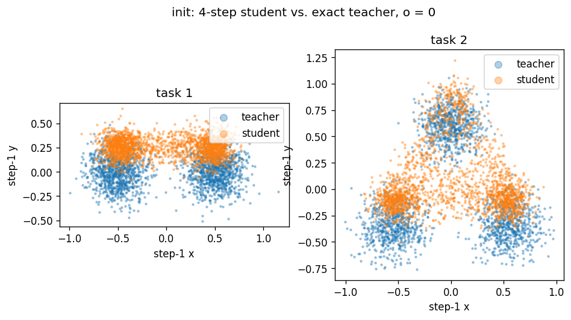 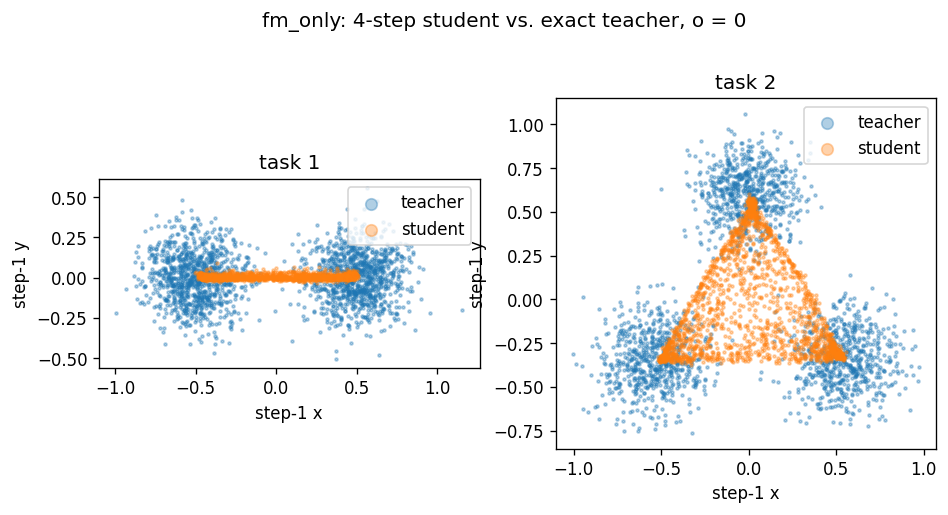
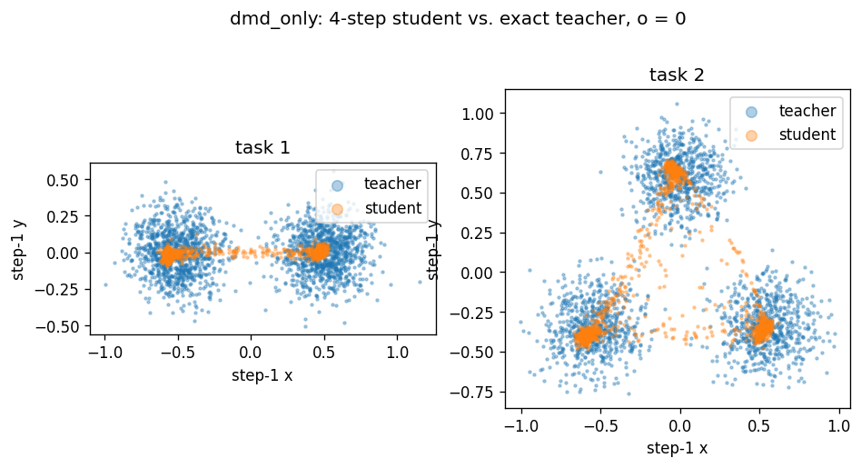 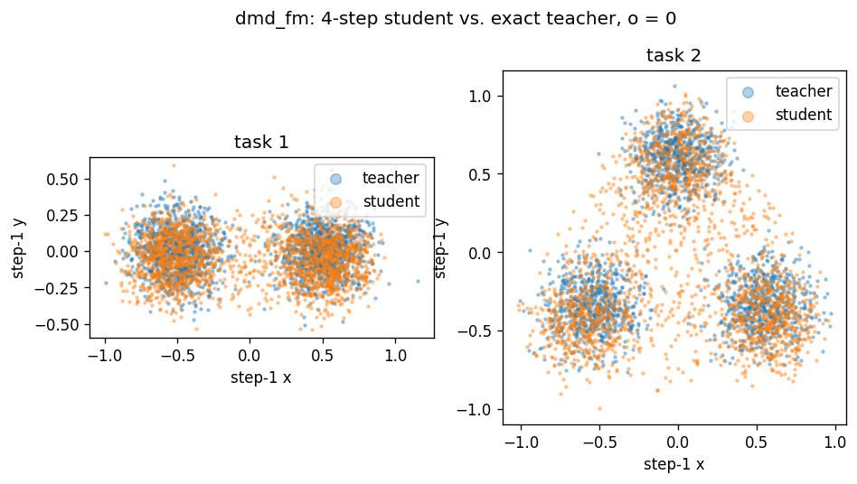
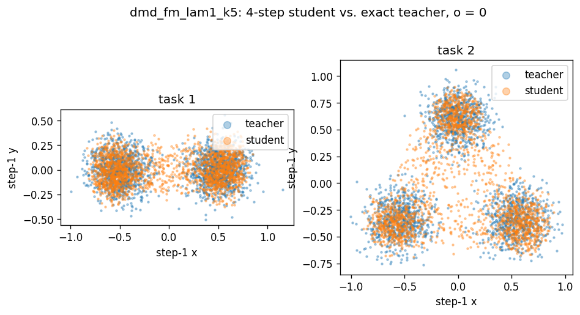 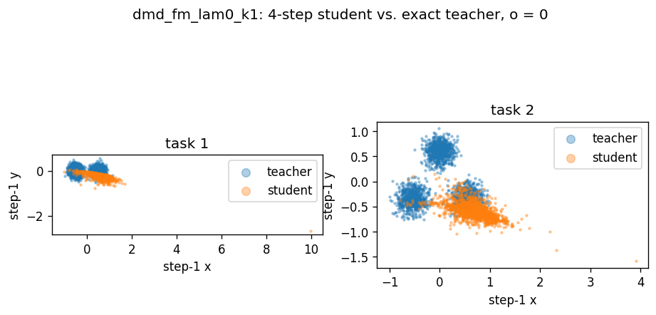
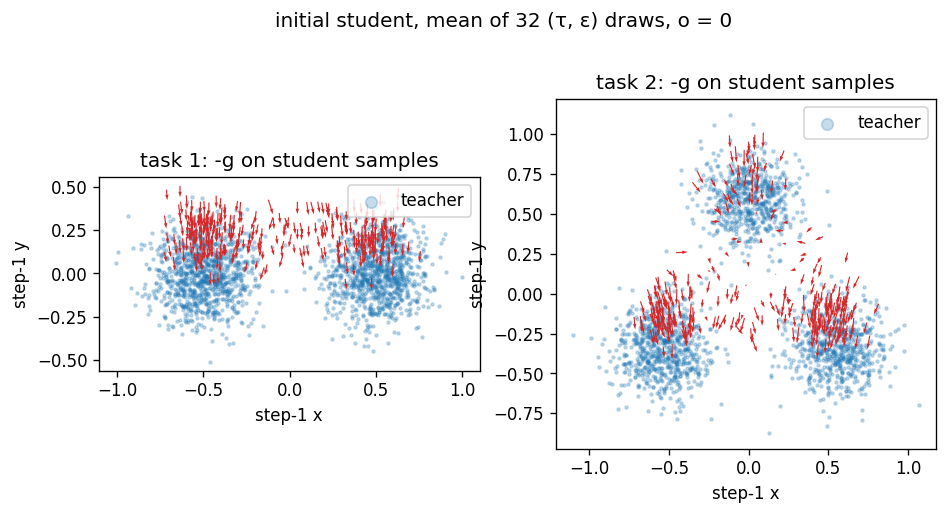

Training curves of `dmd_fm` (each point is the mean of 10 updates):
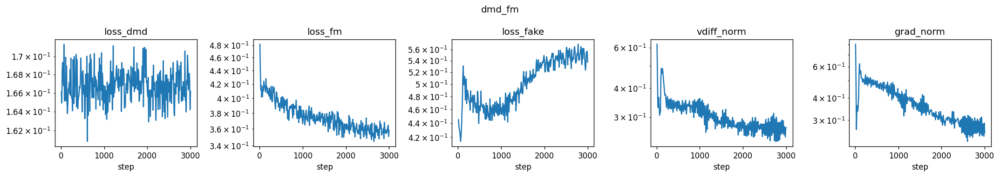

## Findings
- **DMD only keeps every mode but collapses each one.**
  - Coverage stays 2/2 and 3/3; no mode is dropped. But the samples shrink to tight blobs at the mode centres, joined by thin bridges.
  - Success therefore rises above the exact teacher (0.973/0.938 vs. ≈ 0.90), while W2 never improves for long: best 0.115/0.108 at step 500, final 0.196/0.154, jumping by up to 0.07 between consecutive evaluations.
  - The normalized g has a fixed size, about (1 − τ), no matter how close the student is, so nothing damps the updates. A lagging fake (K_ψ = 1) keeps pushing inward.
  - High success alone can therefore mean collapse.
- **FM only cannot beat the teacher it copies.**
  - W2 plateaus from step 250 at about 0.15/0.17 (final 0.148/0.174): worse than the 4-step teacher (0.091/0.093), and on task 2 worse than the initial student.
  - The samples collapse onto filaments between the modes. FM learns the 4-step teacher's sample distribution, which is already under-dispersed, and the student's own 4-step solve adds a second discretization error.
  - A scratch check (not logged) sampled the final FM-only student with 100 steps and came back to about the 4-step teacher's W2, so the problem is discretization, not a bug.
- **Only DMD + FM beats the 4-step teacher.**
  - At λ_IDA = 1, K_ψ = 5 it is 1.8–2.3× better on W2: 0.046/0.052 vs. 0.091/0.093 at n = 2,000, and 0.038/0.049 vs. 0.087/0.090 at n = 20,000. DMD uses the exact teacher velocity at noisy points, not the teacher's 4-step samples.
  - Success stays below the 4-step teacher. On task 1 the 4-step teacher (0.916) beats the exact teacher (0.90) by under-dispersing, so the success bar partly rewards under-dispersion.
- **K_ψ is the largest effect among the stable settings.** λ_IDA ≤ 0.9 changes results more, but by destabilizing them.
  - Going from K_ψ = 1 to 5 lowers the final W2 1.9–2.1× at λ_IDA = 1 (0.095/0.098 → 0.046/0.052), but only 1.3–1.4× at λ_IDA = 0.99 (0.076/0.074 → 0.057/0.053). At K_ψ = 5, W2 reaches ≈ 0.06 within 250 updates, a level K_ψ = 1 never reaches in 3,000.
  - At K_ψ = 1 with λ_IDA = 0.99, the fake lags: its loss creeps up from 0.445 to about 0.55, and success drops from 0.921/0.855 (step 500) to 0.792/0.701 as the samples spread wider than the teacher's.
- **IDA stronger than λ_IDA = 0.99 is harmful.**
  - λ_IDA = 0.9, K_ψ = 1 is the best K_ψ = 1 run up to step 750 (W2 0.106/0.088). It then drifts off every mode (coverage 0 by step 2,000; final W2 0.42/0.40) while its fake loss climbs to 2.5. With K_ψ = 5 it survives but degrades from 0.063/0.062 at step 500 to 0.098/0.081.
  - λ_IDA = 0 diverges at both K_ψ, in distribution only. At K_ψ = 1 the samples are off every mode by step 250 (W2 1.15/1.15); the 10-update mean of the fake loss then peaks near 1.0e6 (step 970) and ‖v_ψ − v_T‖ near 1.1e3 (step 960). FM then pulls it back to 1 mode per task. At K_ψ = 5 it drifts steadily to W2 2.6/4.0, with fake loss 64.
  - Likely cause: the student's velocity field is not the velocity field of its own 4-step sample distribution, so pulling ψ toward θ corrupts the fake's estimate.
- **No run went non-finite.** The fixed-size g bounds the DMD push, so instability shows up as drift in the samples, not as NaN.
  - The early warning was a steady rise in `loss_fake` and `vdiff_norm`. Stable K_ψ = 5 runs stay flat (fake loss 0.46–0.49, ‖v_ψ − v_T‖ 0.15–0.17).
  - `loss_dmd` ≈ ½·E[(1 − τ)²] ≈ 0.166 by construction and carries no information.
- **Noise.** There is one training seed. At a plateau, W2 moves by about 0.005 between consecutive evaluations (e.g. 0.044–0.050 for `dmd_fm_lam1_k5`), so W2 differences below about 0.01 are not meaningful.

## Recommended settings for the GR00T runs
- **α_DMD = α_FM = 0.5.** DMD alone collapses each mode, and FM alone copies and compounds the few-step bias of the teacher's sampler. Only the mix beat the 4-step teacher.
- **K_ψ = 5.** It is the largest gain among the stable settings: 1.9–2.1× lower final W2 than K_ψ = 1 at λ_IDA = 1 and 1.3–1.4× at λ_IDA = 0.99, and in 250 updates it reaches a W2 that K_ψ = 1 never reaches in 3,000. It cost about 1.5× wall time on the toy (117–133 s vs. 75–88 s).
- **λ_IDA ∈ {0.99, 1}.** At K_ψ = 5 the two are indistinguishable at one seed: the final W2 gap is ≈ 0.01/0.001, within the eval scatter. λ_IDA = 1 (no IDA) is marginally better, but no setting clearly passes (see the verdict). Do not use λ_IDA ≤ 0.9: unstable at both K_ψ.
- **Log `loss_fake` and `vdiff_norm`**, and treat a steady rise as a stop signal. Do not track `loss_dmd`.
- **Judge success together with W2/coverage.** Success above the exact teacher's level signals collapse, not quality.

## Deviations and notes
- The pretraining base was retuned by the TOY agent (spec allowed it).
- `metrics.reference_levels` gained an `n` argument (default 2,000).
- The log adds to the contract format: `final_n20000` = {student, initial_student, reference}, all evaluated with the eval seed; `diverged` (null, or the step at which a metric went non-finite; no run hit it); and `eval_seed`, `eval_every`, `log_every` in the config.
- Each training row is the mean over the 10 updates since the previous row.
- `report.py` computes the DMD arrows with the public `step.dmd_direction_at_noisy`, the helper `distill_step` uses, instead of re-implementing it.
